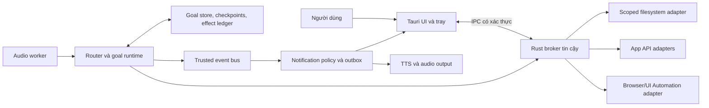
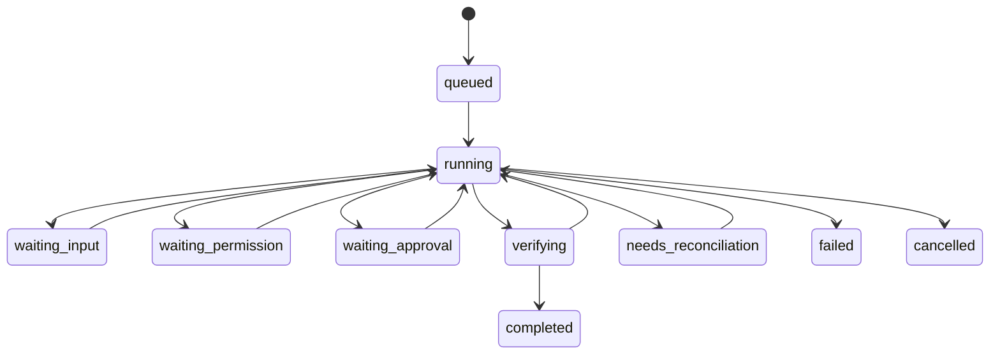

# Kiến trúc đề xuất

Trạng thái: **proposed implementation**, chưa có desktop build hoặc integration production. Các quyết định được giải thích trong [ADR](adr/0001-windows-local-first.md).

## Ranh giới tiến trình

UI hiển thị mic state, transcript, goal progress, permission cards, preview, evidence và kill switch. Không giữ connector secrets hoặc generic shell. Remote content không được có quyền core. Tauri capabilities chỉ hạn chế WebView → core; mã Rust/sidecar vẫn cần được tin cậy hoặc cô lập riêng. [Tauri security](https://v2.tauri.app/security/capabilities/)

Rust broker là ranh giới hành động: xác thực caller, kiểm tra grant hiện tại, validate schema/target, khóa approval với preview, kiểm tra budget/cancel, thực thi adapter và trả receipt. Python worker điều phối nhưng không được `eval` model output, cài package từ lệnh model hoặc lách broker qua generic filesystem/shell tools.

Trong threat model bản đầu, audio/goal sidecar là mã first-party được review và ký; tách process không tự tạo security sandbox. Plugin hoặc mã không tin cậy cần containment thật trước khi hỗ trợ. Spike AppContainer/restricted-token phù hợp cho worker không cần desktop access; adapter UI được giữ trong broker có quyền giới hạn vì AppContainer window isolation cản can thiệp app khác. Job Objects giúp giới hạn resource/thu hồi process tree, không tự thay thế security limits. [AppContainer isolation](https://learn.microsoft.com/en-us/windows/win32/secauthz/appcontainer-isolation), [Job Objects](https://learn.microsoft.com/en-us/windows/win32/procthread/job-objects)

IPC nên dùng named pipe với ACL theo user/instance và thông điệp có schema/version/nonce; xác thực lại cho effect. Tránh endpoint localhost không xác thực mà website bất kỳ có thể gọi. Token cloud tồn tại phía broker/OS secret store; model và WebView không thấy secret. Thiết kế ACL/containment phải được thử trên Windows trước beta.

## Chạy nền, ngủ và khởi động lại

User process + tray, autostart opt-in, nút mute rõ. Đóng cửa sổ có thể thu về tray nếu người dùng chọn; Quit phải thoát và tắt mic. Supervisor quản lý child processes và resume goal khi user session khả dụng. Không dựa vào Windows Service cho tương tác mic/UI. [Microsoft services](https://learn.microsoft.com/en-us/windows/win32/services/interactive-services), [Tauri autostart](https://v2.tauri.app/plugin/autostart/)

Khi khóa màn hình: mặc định mute capture, không tiếp tục UI action; chỉ các tác vụ nền đã được cấp đúng quyền mới có thể tiếp tục. Khi máy sleep/offline, lưu trạng thái; reconnect/resume bắt đầu bằng reconciliation. Local assistant không tiếp tục chạy khi máy tắt. Không thay power plan, registry hoặc lịch khởi động của máy ngầm.

## Voice runtime

Capture → echo handling/noise handling → VAD → endpointing → ASR → structured request. VAD chỉ phát hiện speech; endpointing cần quyết định đã hết lượt nói. Streaming partial transcript không đủ để thực thi số tiền, người nhận hoặc target path chưa xác định.

Cascade là baseline. Dùng Pipecat nếu spike cho thấy giảm công xây turn-taking; LiveKit khi có browser/mobile sessions hoặc multi-device realtime nhu cầu thật. Không lắp cả hai chỉ để so sánh framework. TTS adapter phải hỗ trợ cancel/flush; context giữ phần thực sự đã nghe. [LiveKit turns](https://docs.livekit.io/agents/logic/turns/), [Pipecat interruptions](https://docs.pipecat.ai/pipecat/fundamentals/interruptions)

Giới hạn raw audio trong RAM buffer ngắn; lưu để eval chỉ khi opt-in. Capture, STT, endpointing, model reasoning/tool use, TTS và playback có latency metrics riêng. Speech-to-speech là adapter nâng cấp; không bypass action pipeline.

## Router và goal runner

| Tuyến | Khi dùng | Contract |
|---|---|---|
| Answer | Không cần environment mutation hoặc discovery dài | Trả lời; nêu giới hạn dữ liệu nếu có |
| Bounded tool | Thao tác hẹp, đã biết tool và đầu ra | Broker → tool → verifier |
| Durable goal | Dependency/discovery/chờ/resume/acceptance checks nhiều bước | Goal store, plan, checkpoint, ledger, budget và verifier |
| Unsupported | Không tool được cài/được hỗ trợ xử lý được | Không tự bịa tool; đề xuất capability request nếu product context cho phép |

Các gate `waiting_input`, `waiting_permission`, `waiting_approval` độc lập với tuyến. Mọi gate chưa được giải quyết phải kiểm tra lại sau resume. Reference [routing.py](../src/nora_policy/routing.py) minh họa quy tắc xác định; chưa có NLP/LLM classifier. Threshold bốn bước là fixture heuristic, phải hiệu chỉnh bằng task corpus.

Lựa chọn runtime dự kiến: LangGraph cho flow local, persistent checkpoints và supervisor riêng. Không dùng `InMemorySaver` cho goal cần qua restart. Chưa chọn/pin saver production: SQLite là ứng viên local store cần durability/locking/migration tests; không coi development saver là bằng chứng sẵn sàng sản phẩm. Nếu cần nhiều ngày/nhiều worker/cloud tenancy, đánh giá Temporal qua ADR tiếp theo. Không xếp cả LangGraph và Temporal trong một critical path ban đầu. [LangGraph](https://docs.langchain.com/oss/python/langgraph/checkpointers), [Temporal](https://docs.temporal.io/workflows)

## Tính bền vững và external effects

Trước effect: persist intent (`effect_id`, target, canonical arguments hash, grant revision, approval ref). Gửi idempotency key nếu được hỗ trợ. Sau effect: persist receipt và verify actual state. Nếu effect đã xảy ra nhưng receipt thất lạc, query theo identifier trước retry. Nếu không biết, dừng nhánh ở `needs_reconciliation`. Model output, checkpoint và local transaction không tạo exactly-once guarantee với app bên ngoài. [Temporal Activities](https://docs.temporal.io/activity-definition), [LangGraph resume](https://docs.langchain.com/oss/python/langgraph/interrupts)

Budgets chặn step, elapsed time, cost và worker concurrency. Quota dành riêng cho verification/reconciliation, tránh tiêu hết token rồi không kiểm tra kết quả. Replan có version; không đổi goal hoặc acceptance criteria ngầm. User hủy thì ngừng bước mới, thử hủy calls đang chạy khi adapter hỗ trợ, báo effects đã hoàn tất.

## Store và memory

| Store | Dữ liệu | Kiểm soát |
|---|---|---|
| Goal/checkpoint | Plan, state, pending approvals | Transactions, schema version, backup/recovery |
| Effect ledger | Intent, receipt, reconciliation | Immutable identifiers, audit redaction |
| Notification outbox | Pending/delivered per channel | Dedupe, expiry, stale-event checks |
| Fact store | Facts kèm nguồn/ngày/scope | TTL, user edit/delete, grant checks |
| Conversation | Transcript phù hợp và played audio text | Retention, export/delete |
| Secret store | Tokens theo connector | OS protection, rotation/revoke; không vào prompt |

Không dùng vector database chỉ vì có memory. SQLite + structured records/full-text là baseline cần đánh giá; thêm semantic retrieval khi corpus và recall tests đòi hỏi. Thiết kế NORA yêu cầu raw audio không đi vào tracing mặc định; phải cấu hình exporter/redaction chủ động, vì một số SDK bật tracing mặc định. Không lưu hidden chain-of-thought; dùng quyết định, trạng thái và evidence phục vụ audit.

## Hai delivery surfaces

`LifeMateAdapter`: nhận dataset contract và tool schemas của devkit; gọi môi trường mô phỏng, xuất JSONL đúng contract. Chưa được triển khai trong repo này.

`DesktopAdapter`: typed filesystem/app tools qua permission broker; có lifecycle, consent, rollback/reconciliation thực. Kết quả LifeMate không tự cho phép thực thi banking/ride/email ngoài đời.

Optional web dashboard không nắm quyền desktop mặc định. Chưa chọn cloud provider, chưa provision dịch vụ tính phí; không có provider SDK hardcoded trong reference core.
