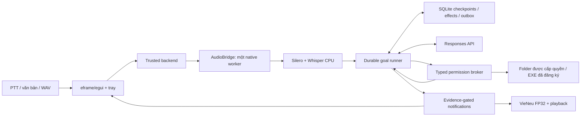
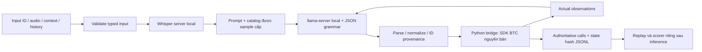

# Kiến trúc NORA đang triển khai

Cập nhật 03/11/2026. Nguồn có hai delivery surfaces: desktop Windows dùng LLM API và adapter LifeMate offline. Bản desktop là unsigned validation candidate; chất lượng LifeMate chưa đạt mục tiêu. Đây là mô tả code hiện có, thay cho thiết kế Tauri/LangGraph cũ; lịch sử quyết định nằm trong các ADR.

## Desktop Windows

`nora-app` khởi tạo Windows Job, cấu hình và UI; `nora-desktop` chỉ gửi command qua bounded channels. `nora-runtime::backend` giữ quyền tạo goal, thay grant và duyệt proposal. Model chỉ đề xuất typed tool calls. App không mở microphone hay gọi API khi chỉ khởi động.

PTT dùng Ctrl+Shift+Space. Audio được giới hạn thời lượng, resample/VAD rồi gửi tới native worker. ASR và TTS chạy tuần tự: không giữ hai model worker resident cùng lúc. `nora-platform::sandbox` tạo AppContainer không có network capability và nested one-process Job, chỉ cho đọc binary/assets và ghi scratch của chính worker. Lease gắn PID và creation time phục vụ khôi phục/dọn dẹp. Sandbox không bảo đảm native parser hoặc driver không có lỗi.

Goal được lưu trước khi xác nhận admission. Runner có budget cho API/steps/time, checkpoint, journal cho follow-up và effect ledger. Sau crash, thao tác chưa rõ kết quả cần reconciliation; không tự suy ra exactly-once từ transaction local. Một orchestrator hoạt động tại một thời điểm; public research dùng context riêng và cùng ngân sách goal. Đây không phải hệ thống tự sinh số lượng worker không giới hạn. `nora-core::routing` là policy trên structured facts; chưa phải classifier tiếng nói đã được chứng minh.

Broker hỗ trợ list/read/search trong folder có grant, create-new note có preview/readback, calculator, giờ, reminders và mở EXE đã đăng ký theo hash. Quyền read/create/cloud-disclosure tách nhau. Approval có hạn, một lần, gắn đúng goal/action/grant revision. Không có tool shell, xóa file, gửi tin nhắn hay arbitrary GUI automation. App ngoài được mở có phê duyệt chạy ngoài Job và ngân sách NORA.

Thông báo được tạo từ lifecycle/receipt đã tin cậy. Question, approval, finding, blocker và kết quả đã xác minh có thể lên UI/TTS. Technical events, epoch và heartbeat không đổi giữ trong diagnostic; quiet mode và lượt nói của người dùng được ưu tiên. Audio/UI acknowledgements được ghi riêng; playback drain không chứng minh người dùng đã nghe. Hidden reasoning không được lưu vào checkpoint hoặc phát như progress.

## LifeMate offline

`nora-lifemate` không gọi LLM API. Typed input bỏ qua transcript đáp án, label và inline hidden state. Catalog bị giới hạn bởi installed apps/tools của sample; provenance chỉ kiểm giá trị ID đã quan sát, không chứng minh hành động đúng ý. Mỗi call đi qua `ToolEnv.validate` rồi SDK `call`; output lấy call list/state hash thực từ SDK. Python là cầu nối tới SDK bắt buộc, không phải desktop runtime.

Mỗi mẫu có deadline 30 giây, bao gồm ASR/history và tool loop; runner dành khoảng thời gian cho receipt cuối, giữ mẫu failed trong output. `ok=true,done=false` không chứng minh effect hoàn tất. JSON hợp lệ, state hash khớp và intent/call metric là các điều kiện khác nhau. Kiểm tra SDK replay xác minh receipt, không đo chất lượng tác vụ.

Native services nghe numeric loopback với xác thực riêng từng run, môi trường allowlist, tắt proxy/redirect và không truyền API key. Timeout HTTP dùng Tokio background runtime để hủy request tiếp tục được xử lý giữa các pha ASR/LLM. Research Linux process-group ownership khác với Windows AppContainer; không coi chúng là cùng mức containment.

Baseline là compact-typed actor. Các mode typed plan, native tools, progressive catalog, few-shot, aliases và catalog-bound clarification là thí nghiệm opt-in. Mode clarification mới chỉ cho hỏi tên tool được cấp và params thuộc schema, với kiểm tra trước SDK; không chứng minh thông tin thật sự thiếu. Hard tool routers đã bị loại vì thiếu recall. Trên cặp 30 development, few-shot không đạt gates (8,33%→11,67%, tăng failures); alias giảm điểm (8,33%→6,67%). Chưa phương án nào chứng minh 99% hoặc 100%. Xem [sổ thí nghiệm](research/nora-architecture-experiments.md) và [kết quả LifeMate](lifemate-2026.md).

Clarification v30 cũng không đạt quality gate (8,33%→5,00%, nonempty-perfect0/0, mỗi arm1failure). Decoder không enforce `uniqueItems`; runtime guard chặn8lần lặp trong một sample trước SDK. V31 thay uniqueness ở schema nhỏ bằng bounded enum của mọi danh sách không trùng, giữ mọi thứ tự và guard độc lập;2synthetic native probes qua. Probe decoder khác với task accuracy; default actor không đổi.

## Trách nhiệm 12 crates

| Crate | Trách nhiệm |
|---|---|
| nora-app | Executable desktop, chọn startup/diagnostics/runtime |
| nora-desktop | UI/tray, state và bounded contracts |
| nora-runtime | Goal/backend/audio lifecycle, tools, budgets và recovery |
| nora-broker | Grants, approval, capability filesystem và effect verification |
| nora-store | SQLite goal/effect/checkpoint/result/notification storage |
| nora-llm | Cấu hình và transport Responses API có giới hạn |
| nora-core | Routing facts, resource/notification policies |
| nora-audio | PCM/capture/resample/VAD/Whisper/playback primitives |
| nora-vieneu | VieNeu prompt/G2P/heads/sampling/ONNX/TTS streaming |
| nora-platform | Windows Job/AppContainer, process lifecycle và measurements |
| nora-cli | Asset/core/native diagnostic commands |
| nora-lifemate | Contest input/ASR/local LLM/SDK adapter và experimental modes |

## Tài nguyên và giới hạn bằng chứng

Desktop giữ root Job cap **2.000.000.000 bytes commit**, native child **1.700.000.000**. Một synthetic integrated journey đã đo dưới cap; chưa thay cho live microphone corpus, signing, clean-machine testing hoặc mọi laptop 4GB GPU. SSD runtime khác developer model/build caches. [Validation desktop](validation.md) ghi dữ liệu và release gates.

Bản thi được phép dùng A30/64GB của BTC; lattice GTX1650/16GB là máy phát triển. Profile thử có GPU-free headroom guard theo `nvidia-smi` và telemetry 1 giây; sampling có thể bỏ lỡ peak ngắn. Số free phải được đo trực tiếp, không suy `total-used` khi driver có phần reserved. Chưa có benchmark thực trên A30 hoặc điểm public NORA.

PhoWhisper Q5 cải thiện character edits trong phép ASR-only 30 samples/32 utterances. Cặp đầu cuối cùng Q3 4B/context6144 sau đó cho turbo 8,33%, Pho 3,33%; mỗi arm có một failure, giữ trong denominator. SDK replay khớp nhưng Pho không đạt task gate; không đổi default ASR. QLoRA V13 trên lattice có một full945-token update/save/reload, all text linears/rank16, với unused vision storage release và checkpoint-input CPU transport. V14 tiếp tục cùng model/optimizer qua945/1940/2413tokens, rồi dừng bởi GPU512MiB guard trong backward2655; chưa train đủ bảy trường hợp, full SFT, native export hay quality gain. V32 thêm cohort ID-only có SHA-256 để đánh giá đủ123 validation ngoài bộ30, không sửa prompt/SDK hoặc cho phép lọc public submission. Xem review hiện hành để phân biệt từng failure và kết quả đo.

Code/tests có trong repo không đồng nghĩa tất cả capability đã được kiểm chứng trên thiết bị đích. Mã nguồn, private receipts và đo thực là ba lớp bằng chứng riêng. Không commit credentials, dataset, model weights, private predictions/traces hoặc raw training gradients.
