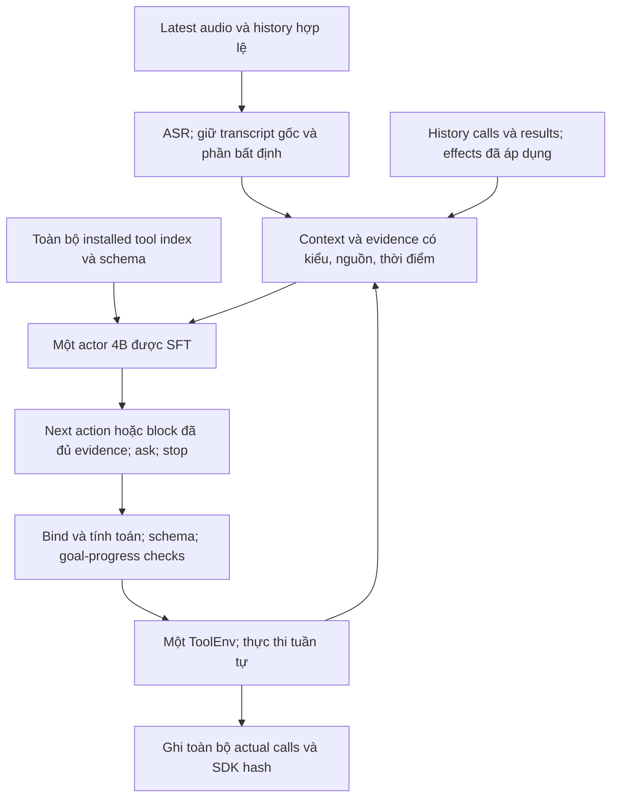

# LifeMate: thẩm định lại kiến trúc 4B theo scorer và dữ liệu

Ngày 03/11/2026. **Kết luận: kiến trúc hiện tại chưa đủ bằng chứng để đạt 100% test BTC. Đề xuất trước cũng chưa chứng minh điều đó và cần sửa trọng tâm.** Bản này thay thế phần quyết định kiến trúc của [nghiên cứu trước](D:/jarvis/docs/research/lifemate-slm-architecture-2026-11-03.md), giữ nguyên các kết quả lịch sử. Đây là nghiên cứu và thiết kế; chưa sửa source, chạy model, train hoặc submit.

**Quyết định:** giữ một backbone khoảng 4B; ưu tiên actor được SFT để chọn hành động tiếp theo từ yêu cầu, history và observations thật. Runtime giữ evidence có kiểu, tính toán xác định, kiểm schema, theo dõi tiến độ và thực thi tuần tự. Không bắt mọi mẫu đi qua một full-plan DSL hoặc một goal frame làm nguồn thông tin duy nhất. Một sketch ngắn cho tác vụ phức tạp chỉ được thêm khi thí nghiệm đối chứng cho thấy tăng điểm dưới deadline.

**1. Sửa cách đọc bằng chứng hiện có.**

| Bằng chứng đã có | Phạm vi thực | Kết luận hợp lệ |
|---|---|---|
| 2,9810% local mirror trên 123 validation; 79/78 failure ở hai arm | Native **Qwen3.5-2B Q4_K_M**, khác placement output; chưa phải A30 | Pipeline này còn rất xa mục tiêu. Không gán điểm này cho 4B |
| Sáu runtime-prefix probes, native không grammar và HF NF4 vẫn có lỗi chọn tác vụ | Cả hai là **Qwen3.5-2B**; chọn hậu kiểm; không thực thi SDK | Lỗi không chỉ xuất hiện khi có grammar trên các ca này. Chưa cô lập quantization/kernel; không suy thành kết quả 4B |
| Drift 114/200 = 57%, 199 unique inputs | HF **Qwen3.5-2B NF4**, MCQ tổng hợp; không phải LifeMate | Baseline hồi quy 2B đã có. 4B cần baseline riêng |
| Các thử nghiệm 4B Q3/Q4 trên bộ 30 cũ | Khác bộ dữ liệu và có nhiều vòng tuning | Dùng làm bằng chứng chẩn đoán; không so trực tiếp với 123 để kết luận model nào tốt hơn |
| PlanTyped synthetic pass nhưng 3/3 audio tasks fail | Probe nhỏ của một implementation cụ thể | Typed plan có thể hợp lệ mà không giải được tác vụ |

Đã đối chiếu [protocol 123](D:/jarvis/.artifacts/lifemate-eval-v32-protocol.md), [receipt model thực](D:/jarvis/.artifacts/lattice-runs/eval-v32-base123/run-receipt.json), [backend protocol](D:/jarvis/.artifacts/lifemate-backend-probe-v1/protocol.md), [drift protocol](D:/jarvis/.artifacts/drift-hf-base-v1-result/protocol.md) và [review lỗi](D:/jarvis/docs/development/lifemate-error-review-2026-11-03.md). Dòng “drift còn thiếu” trong phần cũ của review đã được cập nhật ở phần cuối; không yêu cầu chạy lại baseline 2B chỉ vì đọc đoạn cũ. Training capacity/save/resume/export vẫn là các việc khác chưa hoàn tất.

**2. Muốn 100 điểm phải giải đúng bài toán chấm.**

Đã đọc lại trực tiếp Evaluation và Rule trên [portal BTC](https://challenge.zalo.ai/portal/lifemate). Với gold không rỗng, state hash sai hoặc không có call khớp thì điểm bằng 0. Nếu qua state gate, điểm là `2M / (|P| + |G|)`, matching một-một. Gold rỗng chỉ đạt điểm nếu prediction cũng rỗng. Tool name và tham số không fuzzy cần khớp; fuzzy dùng token-F1 > 0,6 sau lowercase/NFC. Call matching bỏ thứ tự, nhưng replay theo thứ tự. `sys.ask_missing_info` vẫn là call được chấm.

Do đó, 100% mean score đòi hỏi mọi mẫu đạt 1: đúng trạng thái theo SDK và multiset lời gọi khớp hoàn toàn theo metric, kể cả lookup/ask. Ví dụ tổng hợp: gold có 3 calls, agent làm đúng 3 nhưng thêm 1 verification read không khớp gold, state vẫn đúng thì chỉ được `6/7 = 85,71%`. Ngược lại, bỏ read cần thiết để tiết kiệm cũng có thể mất cả điểm. Mục tiêu là học workflow đúng và quy ước annotation; không phải cứ ít calls nhất hoặc cứ thực hiện được effect là đủ.

Các chi tiết từ [SDK utils](D:/jarvis/.artifacts/lifemate-official/unpacked/train+public_test/train/zaic_tools/utils.py), [validator](D:/jarvis/.artifacts/lifemate-official/unpacked/train+public_test/train/zaic_tools/validate.py), [executor](D:/jarvis/.artifacts/lifemate-official/unpacked/train+public_test/train/zaic_tools/executor.py) ảnh hưởng trực tiếp tới thiết kế:

- State equality là equality sau canonicalization, không phải byte equality toàn bộ state. SDK loại các free-text keys và live apps được định nghĩa; list scalar được sắp xếp nhưng **không deduplicate**, list object giữ thứ tự. Không suy ra rằng đổi thứ tự mọi thao tác đều an toàn.
- `validate` kiểm schema, không xác minh entity tồn tại hay đúng ý định. Sai ID/balance có thể trả `ok=true, done=false`. Một `ok` không chứng minh đã hoàn tất.
- `x-one-of` được validator hiểu là có ít nhất một nhóm đủ thông tin, không phải chỉ được đúng một nhóm. Optional có ý nghĩa; có 738 lần cung cấp optional arguments trong train được khảo sát.
- SDK có thể chấp nhận extra argument keys nhưng local scorer so key-set exact. Portal chưa đặc tả hết edge cases; không tự điền defaults hoặc thêm tham số ngoài yêu cầu. Fuzzy tokenizer của mirror cũng chưa được xác nhận là scorer chính thức.
- Chuẩn hóa khi tìm kiếm entity trong SDK và chuẩn hóa để chấm call là hai việc khác nhau. Một query tìm ra cùng người chưa chắc khớp gold query. Không tự đổi case/format của literal exact hoặc đổi timestamp sang biểu diễn “tương đương” mà chưa học quy ước.
- `ask_missing_info` chỉ ghi call, trả `waiting_for_user`, không có người dùng trả lời thêm trong sample. Nó không phải cách xin gợi ý miễn phí rồi tiếp tục.

Runtime chỉ chứng minh được các thuộc tính như đúng kiểu, nguồn ID, tiến độ đã quan sát. Nó không có gold hash để tự biết mình đã đúng toàn bộ tác vụ; goal parser hiểu sai thì verifier dựa vào chính goal đó cũng có thể đồng ý sai.

**3. Dataset thực nói gì về kiến trúc?**

Phân tích mới chỉ deserialize **1.082 internal-train rows** theo whitelist đã có; bỏ qua validation/outer holdout trước khi decode dòng. Không đọc environment files. Đo thời lượng bằng WAV headers, không chạy ASR. [Thống kê](D:/jarvis/.artifacts/lifemate-slm-research-2026-11-03/train-architecture-profile.json), [thống kê bổ sung](D:/jarvis/.artifacts/lifemate-slm-research-2026-11-03/train-architecture-profile-extra.json). Các tỷ lệ dưới đây không đại diện đã biết cho private test.

| Quan sát trên 1.082 train tasks | Hàm ý thiết kế |
|---|---|
| 727 có history — 67,2%; tối đa 24 history turns | Cần hiểu tham chiếu, sửa ý và trạng thái đã thay đổi; không coi latest audio là toàn bộ input |
| 553 dùng nhiều app — 51,1% | Router một miền có thể loại mất nửa sau yêu cầu; cần giữ dependency liên app |
| 84 có gold rỗng — 7,8% | STOP/no-action là nhãn phải học riêng; hỏi lại mọi câu ngoài phạm vi sẽ sai |
| 160 có ask — 14,8%; 58 trong số đó có write trước ask | Phải hoàn thành phần độc lập đủ thông tin rồi hỏi phần còn thiếu khi đúng yêu cầu; không đặt một clarification barrier trước tất cả writes |
| 45 mẫu chỉ ask; mọi ask trong tập này ở cuối trajectory | Phân biệt thiếu dữ kiện ngay từ đầu với thiếu sau lookup; dừng khi chờ user |
| 2.455 gold calls: 1.102 read, 1.193 write, 160 meta | Read chiếm 44,9%; write-only model bỏ mất một phần lớn workflow |
| 2.640/3.151 top-level argument entries là non-fuzzy — 83,8%; 866 có x-ref | Copy/bind đúng nguồn và chuẩn hóa giá trị quan trọng hơn văn phong câu trả lời |
| 682 calls chứa optional arguments; không có extra keys ngoài schema | Không xóa toàn bộ optional fields, cũng không tự điền toàn bộ defaults |
| 147 tools/46 apps; mẫu có median 31, p95 50, max 62 installed tools, chưa cộng sys đặc biệt | Trước hết thử toàn bộ schema đã rút gọn đúng nghĩa; chưa có lý do mặc định thêm neural retriever |
| Gold dùng 145 tools; 44 tools chỉ xuất hiện ≤5 lần; 2 tools chưa có gold call | Dữ liệu hiếm là vấn đề thật. Không cấm tool chỉ vì chưa xuất hiện trong train |
| 77/147 tool specs có returns rỗng | Không thể sinh mọi outcome contract chỉ từ trường returns; cần đối chiếu public SDK code và observed results |
| 894/1.082 mẫu có ≤3 calls; max quan sát 6 | Ưu tiên actor ngắn và block các hành động đã đủ evidence. 6 không phải max hợp lệ cho hidden test |
| Có 1 mẫu lặp exact call trong gold; 5 mẫu có current call trùng history call | Blacklist toàn cục theo tên+args có thể loại nhãn cần đạt; phải xét current goal, state version, outcome và annotation ambiguity |
| Latest audio: median 6,943s, p95 11,799s | Không thiết kế ASR chỉ trên audio ngắn demo |
| Tổng latest + history user audio: median 13,239s, p95 41,254s, max 69,412s | History ASR phải nằm trong budget 30s; batch/cache hợp lệ quan trọng |

Hai tools chưa có gold call trong internal train vẫn được installed ở nhiều mẫu: `contacts.get` và `email.send`. Đây là coverage gap, không là bằng chứng tool bị cấm hay không xuất hiện ở test. Tập actor V2 có 3.377 training records từ 1.082 tasks; số prefix records không phải số nhiệm vụ độc lập. Có 2.150 history assistant turns mang tool calls và results: đây là nguồn grounding sẵn có, tránh đọc lại hoặc thực hiện lại một effect đã tồn tại.

`label.final_state` chỉ mô tả changed apps, không phải full initial/final environment để làm input policy. Đã giữ hash train `24c42c79fbe8db932fe9817d041c0d0ca422ac8177b413cc1be0cda1fd8941a8` và split manifest `bb8a53c7d80ebc8f4f951ab26f09c25269667b4e0e3e41ddb351fe761ade325d` trong receipt thống kê.

**4. Kiến trúc chốt cho ứng viên đầu tiên.**

**Actor 4B làm phần ngữ nghĩa.** Nó đọc nguyên yêu cầu cùng phần history liên quan; nhận diện intent, phủ định/điều kiện, sửa yêu cầu, chọn đúng entity và bước tiếp theo. Đầu ra ngắn gồm next action hoặc một block các calls đã có đủ nguồn tham số, cùng trạng thái continue/complete/awaiting-user. Không bắt nó viết giải thích dài, tự phát minh IDs, tính ngày/số bằng token hoặc sinh một full program trước khi có observations.

**Runtime làm phần có thể tính và kiểm.** Evidence lưu namespace, field path, nguồn context/history/current observation, kiểu, thời điểm và trạng thái còn hiệu lực. Model chọn binding, runtime copy giá trị nguyên bản vào argument; copy đúng nguồn không thay việc chọn đúng người/đơn. ID cùng chuỗi ở hai app là hai thực thể khác nhau. Thực thể đã xóa/hủy hoặc result cũ không tự coi là trạng thái hiện tại.

Model chọn phép biến đổi ngữ nghĩa như ngày tương đối hoặc một phần số tiền; runtime thực hiện phép tính xác định khi đầu vào rõ. Đầu vào chưa rõ vẫn phải do policy xử lý theo request và evidence; không biến mọi cách diễn đạt tiếng Việt thành một bộ regex đoán ý. Giữ source span bên cạnh interpretation; không chỉ giữ summary do model viết rồi mất khả năng đối chiếu.

**Tiến độ theo từng mục tiêu.** Mỗi phần yêu cầu có trạng thái chưa làm/đợi evidence/đã hoàn tất/đợi user hoặc không áp dụng vì điều kiện sai. Chỉ đánh dấu hoàn tất bằng outcome contract của tool và observations; `ok` hoặc model tự nói finished không đủ. Xử lý lời sửa ý trước khi hành động; history effects đã có, không replay chúng để “khôi phục” state. Không tự đảo ngược một effect cũ nếu user không yêu cầu.

**Thực thi ít vòng nhưng có feedback.** Một block chỉ chứa calls mà arguments và điều kiện đã được grounding; execute tuần tự, cập nhật evidence sau từng call. Nếu call sau phụ thuộc result chưa biết hoặc result bất ngờ, dừng phần phụ thuộc và quay về actor. Không đoán ID mới tạo trước khi SDK trả lại. Giữ thứ tự có thể ảnh hưởng IDs/lists/state; không parallel writes chỉ vì metric matching bỏ thứ tự. Không áp hard cap 6 calls vì max trong train là 6.

**Giảm lặp theo trạng thái, không cấm tên tool.** Nhận diện đề xuất giống nhau trong cùng goal/evidence version và kết quả đã biết; trả lỗi ngắn có cấu trúc cùng thông tin còn thiếu. Chỉ coi retry có ích khi có evidence/arguments/điều kiện mới hoặc retry contract phù hợp. Không bơm lại nguyên văn cả chuỗi sai đến hết 30s. Không bỏ actual rejected calls khỏi submission.

**Tool exposure mặc định đầy đủ trong phạm vi installed apps.** Rút gọn JSON nhưng giữ descriptions cần phân biệt, required/optional, enum, format, x-ref, x-one-of và ý nghĩa returns. Đo token bằng đúng tokenizer; nếu vượt budget mới dùng full index + progressive schema có đường mở rộng mọi tool, gồm dependencies. Selection/inspection nội bộ không phải SDK call. Không dùng top-k cố định loại vĩnh viễn tool; lexical/semantic router cũ đã mất gold tools trong probe.

**Chỉnh so với đề xuất trước:** short goal frame là một augmentation để thử, không là giao diện bắt buộc. Actor trực tiếp + typed runtime là đường chính. Với bài đơn giản, thêm lần gọi model để tạo frame rồi thêm lần dịch frame thành plan vừa tăng latency vừa tạo thêm nơi sai. Với bài phức tạp, sketch giữ conditions/exclusions có thể hữu ích, nhưng phải giữ yêu cầu gốc và chứng minh điểm tăng. Grammar bảo vệ cấu trúc đầu ra; không được gọi đó là bảo đảm hiểu đúng.

**5. Dùng ngân sách 4B ở đâu cho hiệu quả?**

Backbone đối chứng đầu tiên: **Qwen3-4B-Instruct-2507**, non-thinking, Apache-2.0; challenger là Qwen3.5-4B. Đây là lựa chọn để kiểm chứng có kiểm soát, chưa phải xếp hạng chất lượng LifeMate. Không suy rằng model mới hơn tự động tốt hơn tiếng Việt/tool use. [Qwen3 model card](https://huggingface.co/Qwen/Qwen3-4B-Instruct-2507), [Qwen3.5 card](https://huggingface.co/Qwen/Qwen3.5-4B).

Một bộ weights 4B có thể dùng qua nhiều bước; không cần LLM riêng cho router, planner, critic, answerer. SFT cho actor, pointer/binding, ask và stop trước. Giữ raw user request để tránh information bottleneck. Không thêm TTS vào đường thi nếu output chỉ là calls/hash. Quantization tiết kiệm bộ nhớ, không giảm parameter count.

| Cấu hình ASR cần so với cùng actor 4B | Tổng danh nghĩa xấp xỉ | Vai trò |
|---|---:|---|
| PhoWhisper-medium 0,769B | 4,79B nếu LLM 4,022B | Đối chứng kế thừa, chưa được promote từ CER |
| Qwen3-ASR-0.6B | 4,62B | Ứng viên gọn, model card hỗ trợ tiếng Việt |
| PhoWhisper-large 1,55B | 5,57B | Thử đổi phần ngân sách còn dư lấy ASR mạnh hơn |
| Qwen3-ASR-1.7B | 5,72B | Một ASR lớn hơn, ít dư cho neural components khác |
| PhoWhisper-medium + Qwen3-ASR-0.6B | 5,39B | Chỉ thử sau: re-decode có chọn lọc khi số/tên/phủ định bất định |

Các con số là budget ước lượng, không chứng nhận hợp lệ: phải đếm checkpoint, adapters và mọi neural component thực dùng; không dùng load/unload để lách tổng. Qwen3-ASR có tiếng Việt và Apache-2.0; PhoWhisper có BSD-3-Clause, medium 769M/large 1,55B theo tác giả. Tăng kích thước không chứng minh downstream tăng. [Qwen3-ASR](https://huggingface.co/Qwen/Qwen3-ASR-0.6B), [PhoWhisper](https://github.com/VinAIResearch/PhoWhisper).

Lựa chọn ASR bằng paired audio→SDK score và lỗi critical slots: tên, số điện thoại, tiền, ngày giờ, phủ định. Không dùng CER làm tiêu chí duy nhất. Selective second pass/N-best là giả thuyết cần đo; hai recognizers có thể cùng sai, và entity tồn tại trong app không chứng minh user đã nói entity đó. Dùng deterministic decoding; không chạy nhiều lần stochastic rồi chọn bằng gold. Không sửa mất số hoặc tên chỉ dựa vào điều “có vẻ hợp lý”.

A30 là máy nghiệm thu, không ép kiến trúc thi theo VRAM GTX1650. Dùng BF16/FP16 làm quality reference trên thiết bị phù hợp; so Q8/Q4 nếu cần tốc độ/bộ nhớ. Tính sơ bộ riêng Qwen3-4B BF16 weights khoảng 8GB và KV 16.384 tokens khoảng 2,25GiB, còn ASR/buffers/activations/workspaces cần đo. Không suy peak từ phép cộng weights. [NVIDIA A30](https://www.nvidia.com/en-us/data-center/products/a30-gpu/), [Qwen config](https://huggingface.co/Qwen/Qwen3-4B-Instruct-2507/raw/main/config.json).

Budget đề xuất để thử, **chưa đo**: ASR/preprocessing ≤8s, tổng prefill+decode actor ≤17s, binding/SDK/serialization ≤2s, dự phòng 3s. Phải đo tail từng mẫu, không chỉ median. Với tổng audio p95 41,254s, chỉ riêng ASR budget 8s đã đòi hỏi real-time factor khoảng ≤0,194 ở ca đó; max 69,412s khó hơn. Batch history audio, prefix caching đúng và output ngắn đáng ưu tiên hơn thêm agent. Không pretranscribe test ngoài clock, không silently bỏ history. Cấu hình context tổng input+output ≤16.384; reserve output trước khi nạp history/schema.

**6. Nghiên cứu bổ sung làm thay đổi quyết định nào?**

Đã tiếp tục dùng Undermind đọc toàn văn có câu hỏi phản biện cho hai paper, lưu [kết quả đọc](D:/jarvis/.artifacts/lifemate-slm-research-2026-11-03/undermind-reassessment-fulltext.json). Đây là bổ sung cho 8 paper đã đọc ở vòng trước; không coi 298 ứng viên của deep search là 298 paper đã kiểm định. Consensus vẫn không có kết quả do quota ở lần gọi trước; Zotero chưa kết nối được. Không gán nghiên cứu này cho hai dịch vụ đó.

Đã cập nhật [BibTeX](D:/jarvis/docs/research/lifemate-slm-sources-2026-11-03.bib) với hai nguồn bổ sung và metadata hội nghị đã xác minh.

*The Constraint Tax* cho thấy trên calendar tổng hợp với Qwen2.5-1.5B, prompt JSON và hard schema đều 100% valid nhưng executable accuracy là 91,5% và 48,0%. Quan trọng: “delayed packaging” của calendar là re-serialization xác định từ output có sẵn, không phải một agent hai bước độc lập đã được chứng minh. Không test 4B/stateful LifeMate. **Hàm ý:** tách validity khỏi correctness và thử interface; không kết luận bỏ grammar sẽ chữa model. [[Ray26b]](https://doi.org/10.48550/arXiv.2605.26128)

*Dynamic Tool Dependency Retrieval for Lightweight Function Calling* dùng lịch sử tên tool, không observations/live execution. Catalog 17–41 tools. Trên TinyAgent với Qwen3-4B, DTDR-L đạt 80,7% function selection nhưng 16,9% whole-plan success; chưa có cơ chế khôi phục recall chung được đo. **Hàm ý:** dependency-aware ranking có thể hữu ích, nhưng hard routing và routing accuracy không chứng minh task success. Bản hội nghị là Findings ACL 2026; cite key Pat25b của plugin phản ánh metadata/preprint cũ. [[Pat25b]](https://doi.org/10.18653/v1/2026.findings-acl.1680)

SAP/APIGen-MT ở [vòng nghiên cứu trước](D:/jarvis/docs/research/lifemate-slm-architecture-2026-11-03.md) hỗ trợ việc học trajectory và provenance, chưa chứng minh 100% hoặc chuyển trực tiếp sang tiếng Việt. Ưu tiên của tôi là huấn luyện đúng phân phối lỗi và grounding của LifeMate, không sao chép nguyên planner/DSL của một benchmark khác.

**7. Dữ liệu huấn luyện cần thay đổi trước khi tăng độ phức tạp model.**

Giữ 1.082 train / 153 engineering-validation / 310 outer-holdout theo manifest. Nhãn của 153 đã được dùng chẩn đoán; không gọi đó là blind test. Scorer lịch sử từng deserialize toàn file trước khi lọc; chưa có evidence holdout labels vào model hay tuning, nhưng cũng không gọi 310 là dữ liệu chưa từng được parse. Phân tích lần này chỉ decode 1.082 train rows.

1. **Train đúng interface inference:** context + history + ASR thực hoặc nhiễu ASR có nguồn → next action/binding/ask/stop. Giữ một arm dùng transcript chuẩn để chẩn đoán trần text; không dùng text gold ở voice inference. Không thay quá nhiều thành phần trong một run.
2. **Tăng coverage phần hiếm:** tạo synthetic độc lập từ schema/SDK được phép, ưu tiên tools hiếm, phụ thuộc liên app, optional arguments, read-only, empty-output và partial-completion-before-ask. Không copy lại entities của một validation case để chữa riêng case đó.
3. **Counterfactual có kiểm chứng:** cùng câu chỉ đổi “chỉ/trừ/tất cả”, “làm/đừng”, ngày/số, cùng tên nhiều người, ID trùng chuỗi khác namespace, history đã làm xong, latest sửa ý. Generated labels phải qua kiểm tra semantic và executor; teacher không tự trở thành gold.
4. **Recovery từ training rollouts:** schema refusal, empty/ambiguous lookup, `done=false`, đã hoàn tất nhưng định lặp. Không nối máy móc gold suffix vào một trạng thái model đã làm lệch. Cấm future result/final state/hash trong causal input; tiếp tục giữ provenance audit hiện có.
5. **Loss và chọn checkpoint:** đủ trọng số cho công cụ, exact arguments và terminal decisions; tránh để free-text dài lấn át. Chọn theo closed-loop score và breakdown, không theo loss/teacher-forced accuracy. Train data giữ causal prefixes dài; không crop/loại outlier để gọi fit thành công.
6. **Chia synthetic theo họ kịch bản trước augmentation.** Hash split theo ID chưa bảo đảm generalization giữa templates; thêm kiểm tra composition/family trong development. Không dùng public/private labels, kể cả gán nhãn bằng external teacher, để train/tune.

SFT/LoRA trên cùng 4B là bước đầu; full SFT chỉ khi cần và đủ compute. RL/preference optimization để sau khi rollout đã đáng tin: reward chỉ `ok`, JSON hợp lệ, ít calls hoặc text similarity đều sai mục tiêu. Không có căn cứ rằng tiếp tục tối ưu training 2B trên GPU 4GB sẽ trả lời được câu hỏi chất lượng của 4B trên A30. Nếu dùng teacher ngoài, chỉ dữ liệu synthetic/được phép chia sẻ; phiên này không gửi dữ liệu thi tới plugins.

**8. Bộ thí nghiệm quyết định, chưa triển khai.**

| Thứ tự | So sánh giữ các yếu tố còn lại cố định | Quyết định rút ra |
|---|---|---|
| A | 4B baseline: transcript chuẩn vs actual ASR, cùng SDK/runtime; có drift 4B riêng | Tách lỗi nghe khỏi actor; không mang baseline 2B sang 4B |
| B | Direct-call SFT 4B vs cùng model + typed bindings/progress | Runtime có tăng actual score hay chỉ tăng số refusal? |
| C | B vs B + short goal sketch/conditional action blocks | Chỉ giữ plan/sketch nếu tăng điểm, không thêm failures hoặc mất conditions |
| D | Thêm lần lượt rare-tool/contrastive/recovery data | Coverage và on-policy errors có cải thiện? |
| E | ASR variants với actor đã freeze | Chọn bằng audio→SDK score dưới 30s; đo riêng critical slots và history |
| F | Precision/backend và backbone challenger, tách từng biến | Chọn quality/latency frontier trên A30, không chọn bằng tên model |
| G | Freeze candidate; outer holdout đánh giá; offline Docker/A30; public đúng quy định | Xác nhận generalization, tái lập, tài nguyên và điểm BTC thật |

Các ngưỡng promotion cần đăng ký trước run, không nới sau khi thấy kết quả. Báo paired per-task differences, mean state-gated score, perfect/nonempty-perfect, state match, call F1 chưa gate để chẩn đoán, missing/extra calls, ask target/params, zero-call accuracy, stale/wrong-namespace references, timeout/failure/context overflow, latency p50/p95/max. Không bỏ sample lỗi, không tính 3.377 actor prefixes như 3.377 tasks độc lập. Kiểm tra cả mutation order và outcome contracts với SDK version đã pin.

Để nói **đã đạt 100% trên một tập**, cần mọi mẫu của tập ấy đạt 1 theo scorer tương ứng, đủ coverage và không timeout. Để nói **đã đạt 100% bài test BTC**, cần kết quả BTC trên đúng public/private tập được nêu; unit tests, SDK replay, train100 hoặc public100 không thay private100. Một architecture diagram không thể chứng minh điều này trước khi đo. Với evidence hiện tại, kết luận đúng là: **chưa đạt; ưu tiên 4B được huấn luyện theo workflow, grounding có kiểu và evaluation đúng metric, rồi mới thêm plan/retrieval/ensemble.**

**Phạm vi bàn giao:** chỉ có bản thiết kế, phân tích thống kê train và nguồn nghiên cứu; không sửa inference/training code, không thay split/labels/runtime defaults, không chạy GPU hoặc nộp bài. Các giới hạn chính thức cần giữ: toàn hệ thống <6B, LLM <5B, context ≤16.384, offline, 30s/mẫu, một ToolEnv; chỉ dùng `validate`, `call`, `get_tool_calls`, `get_state_hash` ở inference. Mọi external model/data phải thỏa cutoff và license BTC. [Rule](https://challenge.zalo.ai/portal/lifemate).
