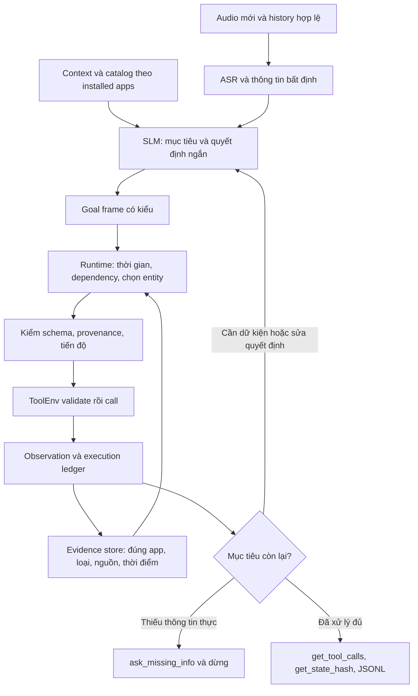

# LifeMate: kiến trúc SLM để tối đa hóa điểm tác vụ

**Đã có thẩm định bổ sung:** đọc [bản đánh giá 4B theo scorer và dataset](D:/jarvis/docs/research/lifemate-4b-critical-review-2026-11-03.md) để xem quyết định hiện hành. Bản mới xác nhận phép đo 123 mẫu và drift/backend probes dùng Qwen3.5-2B, bổ sung thống kê 1.082 train tasks và ưu tiên direct actor + typed runtime; short goal frame trở thành phương án đối chứng, không bắt buộc. Nội dung dưới đây giữ lại đề xuất ở thời điểm nghiên cứu trước.

Ngày nghiên cứu: 03/11/2026, Asia/Saigon. Trạng thái: đề xuất kiến trúc và protocol thí nghiệm, chưa triển khai hoặc đo chất lượng của kiến trúc mới.

**Quyết định đề xuất: dùng một SLM khoảng 4B đã được fine-tune cho LifeMate, phụ trách hiểu yêu cầu và chọn bước tiếp theo; giao việc quản lý thực thể, tính toán, kiểm tra điều kiện, thực thi và ghi nhận hoàn thành cho runtime xác định.** Bắt đầu với Qwen3-4B-Instruct-2507 làm đối chứng có kiểm soát. So sánh Qwen3.5-4B trong cùng điều kiện trước khi chốt backbone. ASR phải được chọn bằng điểm audio → SDK, không chỉ WER/CER. Kiến trúc này là giả thuyết có cơ sở để kiểm chứng, chưa phải bằng chứng đạt 99% hay 100%.

Điểm nghẽn hiện tại là kết hợp của hiểu sai yêu cầu, grounding yếu, quản lý tiến độ và ngân sách thời gian. Việc thêm schema, đổi tên tool hoặc thêm vài ví dụ chưa giải quyết được chúng. Cần thay cách học và điều khiển workflow, đồng thời giữ một baseline đơn giản để biết mỗi thay đổi có ích hay không.

**Phạm vi nghiên cứu và cách dùng công cụ.**

Đã đọc trực tiếp các tab Description, Evaluation, Rule, Submission Guidance trên [portal LifeMate](https://challenge.zalo.ai/portal/lifemate), gồm ảnh công thức điểm; đối chiếu tài liệu dự án và mã Rust hiện có. Đây là lần xác minh trong phiên này, không chỉ nhắc lại snapshot cũ.

Undermind đã hoàn tất [deep search LifeMate](https://app.undermind.ai/projects/f416b7ab-e2e0-4496-bd30-e672bb00702d?path=/Reliable%20small%20models%20for%20stateful%20voice%20tool%20use), trả về 298 paper ứng viên. Đã kiểm tra metadata và đọc toàn văn có câu hỏi cụ thể cho 8 paper: semantic parsing của Shin, Hammer, APIGen-MT, PhoASR, TinyAgent, ToolSandbox, Feedback That Backfires và SAP. **298 là số ứng viên do công cụ trả về, không phải 298 paper đã đọc hoặc đã kiểm định.** Tổng hợp deep-search ban đầu dựa trên abstract/metadata; các kết luận dưới đây ưu tiên phần đã kiểm tra toàn văn và nguồn sơ cấp.

Consensus được gọi ở chế độ deep nhưng từ chối do hết hạn mức miễn phí; không có kết quả Consensus để tổng hợp. Đã đọc skill Zotero và chạy helper `status --json`: không tìm thấy profile, local API/connector tại 127.0.0.1:23119 không phản hồi. Chưa đọc được thư viện hay nhập tài liệu vào Zotero. File BibTeX đi kèm được biên soạn từ metadata nguồn, không phải export của Zotero.

Áp dụng agency-agents với hai profile Research Synthesist và Software Architect, cùng hướng dẫn biên tập turnitout-humanizer. Chỉ tìm nguồn công khai; không gửi audio, transcript, labels hoặc app state của cuộc thi tới plugin nghiên cứu. Không chạy model, training, submission, commit/push hoặc thay cấu hình runtime trong phiên nghiên cứu này.

Ưu tiên tài liệu có trước cutoff tài nguyên 26/10/2026, liên quan trực tiếp đến SLM, tool-use có trạng thái, semantic parsing và tiếng Việt. Loại bỏ bài tổng hợp thiếu nguồn gốc và mọi suy diễn rằng điểm BFCL, validity JSON hoặc demo giọng nói là điểm LifeMate. Ngày phát hành paper không thay thế việc xác minh ngày phát hành, license và hash của checkpoint/dataset thực dùng.

**1. Bài toán chấm thi quyết định kiến trúc.**

Portal xác nhận tổng hệ thống dưới 6B parameters, LLM dưới 5B, context cấu hình không quá 16.384 tokens; inference offline, tối đa 30 giây/mẫu trên một A30, 16 CPU cores và 64 GB RAM. Phải dùng đúng một ToolEnv/mẫu, ghi mọi call thực thi, không đọc trực tiếp environment, clone hay reset để thử nhánh. History đã có effect trong môi trường. Chỉ `validate`, `call`, `get_tool_calls`, `get_state_hash` được dùng lúc inference. Model/dữ liệu ngoài phải công khai trước 26/10/2026 và phù hợp license; không gán nhãn public/private test để train/tune. [Quy định chính thức](https://challenge.zalo.ai/portal/lifemate).

Với gold không rỗng, điểm bằng 0 nếu state hash sai hoặc không có call khớp. Khi state đúng, điểm là `2M / (|P| + |G|)`, với matching một-một; call matching không xét thứ tự, nhưng execution vẫn theo thứ tự và có thể đổi state. Trường không fuzzy phải exact; trường fuzzy dùng token-F1 > 0,6 sau lowercase/NFC. Gold rỗng chỉ đạt điểm khi prediction rỗng. Timeout/execution failure nhận 0. [Evaluation](https://challenge.zalo.ai/portal/lifemate).

Hệ quả thiết kế do tôi suy ra: hoàn thành effect chưa đủ để đạt điểm tuyệt đối. Ví dụ gold có 3 calls, agent gọi đúng cả 3 nhưng thêm một lookup không khớp gold: dù state đúng, điểm chỉ `6/7 ≈ 85,71%`. Vì vậy không tự thêm verification reads, confirmations hoặc thao tác “cho chắc”. Bộ verifier ưu tiên kết quả đã quan sát, kiểu dữ liệu và tiến độ trong bộ nhớ. Ngược lại, bỏ lookup cần thiết chỉ để giảm số call cũng sai. Cần học kế hoạch đủ và chính xác theo task, không tối thiểu hóa số call một cách mù quáng.

Không có mô hình nào biết gold tại inference. Mục tiêu hợp lệ là học quy ước tool-use từ training và tổng quát hóa, không dựng hash hoặc khớp trực tiếp reference ẩn. Local scorer vẫn là mirror xấp xỉ; một số chi tiết fuzzy tokenization chưa được portal đặc tả đủ để coi mirror là scorer chính thức.

**2. Bằng chứng hiện tại của NORA: cần ưu tiên chất lượng trước tối ưu vi mô.**

Các số dưới đây được đọc từ receipts tổng hợp và báo cáo dự án; phiên này không chạy lại các thí nghiệm.

| Quan sát | Hàm ý có cơ sở | Điều chưa được chứng minh |
|---|---|---|
| Hai arm trên 123 internal-validation cùng đạt 2,9810%; 79/78 failures; nonempty-perfect 2/2 | Baseline thực còn rất xa mục tiêu; latency và điều khiển nhiều lượt là vấn đề lớn | Không thể suy ra tỷ lệ trên hidden test |
| 45 mẫu lặp call đã thực thi; 45 mẫu có tổng 240 provenance refusals ở arm A | Cần trạng thái tiến độ và recovery có cấu trúc | Chặn lặp tự nó chưa tăng task score |
| 74/673 calls ở 14 mẫu có `ok=true, done=false` | SDK chấp nhận chưa đồng nghĩa effect hoàn tất | Không được diễn giải các calls đó thành giao dịch thành công |
| Lexical/semantic hard routing chỉ giữ 55/68 và 52/68 tool cần dùng trên ASR30 | Không dùng các filter này để loại vĩnh viễn tool | Không bác bỏ mọi phương pháp retrieval có huấn luyện |
| PlanTyped v25: 3/3 audio samples failed, 0% local score; synthetic probe trước đó pass | Typed executor đã có, nhưng planner/runtime thực chưa đạt | Không được quảng bá “typed plan đã giải quyết bài toán” |
| Alias v29: 8,3333% → 6,6667%; fixed few-shot v28: 8,3333% → 11,6667%, thêm failures, không thêm nonempty-perfect | Các profile cụ thể không đạt promotion gates | Không kết luận mọi SFT/augmentation đều vô ích |
| PhoWhisper Q5 giảm CER local so với Whisper turbo; paired Q3 task score lại 8,3333% → 3,3333% | Chọn ASR theo điểm downstream | CER tốt hơn chưa đủ để promote |

Nguồn: [review 123 validation](../development/lifemate-error-review-2026-11-03.md), [nhật ký kiến trúc](nora-architecture-experiments.md), [LifeMate project record](../lifemate-2026.md). Best historical audio 13,5556% là trên bộ 30 khác; không so trực tiếp với 2,9810% trên 123 mẫu để kết luận model giảm chất lượng.

Đọc mã cũng thấy khoảng trống cụ thể: `IdProvenance` trong `grounding.rs` lưu các ID quan sát vào một `BTreeSet<String>`. Check có đọc `x-ref` nhưng điều kiện membership chưa gắn ID với đúng namespace. Vì vậy “đã thấy ID” chưa chứng minh “ID phù hợp tham số này”. `runner.rs` có kiểm `ok`/`done`, nhưng completion còn phụ thuộc quyết định `finished` của model; nó chưa chứng minh bao phủ đủ mục tiêu người dùng. `plan.rs` hỗ trợ call/select_unique và predicates, chưa có foreach/date arithmetic. Đây là lý do cần đánh giá năng lực biểu diễn trước khi mở rộng DSL.

**3. Nghiên cứu nào thực sự hỗ trợ hướng này?**

| Nguồn và mức bằng chứng | Kết quả đáng dùng | Giới hạn khi chuyển sang LifeMate |
|---|---|---|
| *Constrained Language Models Yield Few-Shot Semantic Parsers*, EMNLP 2021; toàn văn | Canonical language → formal representation; BART 406M trên SMCalFlow với 300 training examples đạt 0,42 so với 0,30 của unconstrained meaning representation, Table 4 | English text; thí nghiệm bỏ dialogue history. Grammar không bảo đảm đúng ý định. [[Shi21]](https://doi.org/10.18653/v1/2021.emnlp-main.608) |
| *TinyAgent: Function Calling at the Edge*, arXiv 2024; toàn văn | 1.1B được LoRA trên 80K examples, planner DAG; Table 1 đạt 80,06% với Tool RAG, so với 78,89% all-tools | Catalog cố định 16 tools; không đo spoken Vietnamese accuracy. Retrieval classifier 16 lớp không áp thẳng cho catalog biến đổi. [[Erd24]](https://doi.org/10.48550/arXiv.2409.00608) |
| *Hammer*, ICLR 2025; toàn văn arXiv và bản hội nghị | Huấn luyện masking tên function/parameter và irrelevance examples; Hammer-4B đạt 76,05 BFCL trong Table 2 | Không phải thay alias chỉ ở inference; tỷ lệ abstention có trade-off với gọi tool. Không có bằng chứng tiếng Việt/stateful LifeMate. [[Lin24]](https://doi.org/10.48550/arXiv.2410.04587) |
| *APIGen-MT*, bản toàn văn đọc là arXiv v4; có bản NeurIPS 2025 | Blueprint được kiểm tra rồi sinh trajectory bằng executor; xLAM-2-3B có BFCL v3 multi-turn 56,00 và τ-bench overall 38,2, Tables 1–2 | Không phải 56%/38,2% LifeMate. Chủ yếu giữ trajectories thành công, không chứng minh đào tạo recovery từ failures. [[Pra25]](https://doi.org/10.48550/arXiv.2504.03601) |
| *SAP: State-Guided Data Synthesis with Argument Provenance*, arXiv 05/09/2026; metadata ghi accepted EMNLP 2026; toàn văn | Qwen3-4B-Instruct-2507 SFT khoảng 9K trajectories: BFCL v4 MT 22,1 → 30,4; bỏ provenance còn 24,0. τ² average 32,2 → 35,1, Tables 2–3 | English; một nhóm nghiên cứu, chưa độc lập tái lập trên LifeMate. Pipeline synthesis dùng rollback/initial-state access không được sao chép vào contest inference. [[Tia26]](https://arxiv.org/abs/2609.06124) |
| *ToolSandbox*, NAACL 2025; toàn văn | Đánh giá dependencies, canonicalization, thiếu thông tin trên actual interactive trajectories | Milestone similarity khác state-gated call F1; các ví dụ chứng minh lớp lỗi tồn tại, không chứng minh runtime đề xuất chữa được. [[Lu24]](https://doi.org/10.48550/arXiv.2408.04682) |
| *Feedback That Backfires*, preprint 24/08/2026; toàn văn | Verbatim failed-call feedback làm tăng xác suất lặp ở các model 135M–1.7B; abstraction/decoder ban giảm một số repeat metrics | Không test Qwen3-4B; giảm lặp không kéo theo tăng rollout success; paper có chỗ ghi 24/30 rollout tasks chưa nhất quán. Chỉ dùng làm giả thuyết ablation. [[Gum26]](https://arxiv.org/abs/2608.23651) |
| *Vietnamese Automatic Speech Recognition: A Revisit*, Findings EACL 2026; toàn văn | PhoASR là pipeline/dataset; Table 6: Whisper-small fine-tune có normalized WER 8,20 ở cấu hình 3100h, PhoWhisper-small 8,97, ChunkFormer 6,89 trên test của paper | Không phải checkpoint mới đã xác minh sẵn để thay vào NORA; không đo entity/negation/task accuracy. Giấy phép các nguồn dữ liệu khác nhau. [[Vu26]](https://doi.org/10.18653/v1/2026.findings-eacl.345) |

Hai nguồn bổ sung định hướng: *Task-Oriented Dialogue as Dataflow Synthesis* mô hình hóa history bằng graph có reference/revision [[And20]](https://doi.org/10.1162/tacl_a_00333); DAgger giải thích vì sao học trên gold trajectories có thể lệch phân phối khi agent tự tạo sai sót [[Ros10]](https://arxiv.org/abs/1011.0686). Áp dụng ý tưởng recovery cho NORA là đề xuất kỹ thuật, không phải kết quả đã được hai paper đo trên LifeMate.

Kết luận bằng chứng: **khá mạnh cho việc huấn luyện đúng workflow và đánh giá closed-loop; vừa phải cho typed semantic controller; chưa có bằng chứng trực tiếp cho toàn bộ kiến trúc đề xuất trên LifeMate.** Các paper cải thiện tool-use vẫn còn nhiều lỗi. Không paper nào xác lập đường chắc chắn tới 100% hidden test.

**4. Kiến trúc cụ thể: một model, nhiều bước có trách nhiệm rõ.**



Đây là bộ điều khiển dùng chung một bộ weights. Không cần nhiều LLM độc lập hoặc hệ agent tranh luận. Các lời gọi SDK vẫn tuần tự trong một ToolEnv; DAG chỉ thể hiện dependency và cho phép runtime giảm số lần phải hỏi model.

**Goal frame phải ngắn, học được và đủ biểu đạt.** Model xác định các mục tiêu, phạm vi đối tượng, điều kiện, phủ định/ngoại lệ, revision của history và slot còn chưa rõ. Không bắt model viết toàn bộ AST lồng sâu với JSON pointers ngay từ đầu. Có thể dùng canonical form hoặc JSON nông; lựa chọn bằng ablation cùng backbone và dữ liệu.

Ví dụ tự tạo, không lấy từ dataset: “Tắt mọi đèn tầng một, trừ phòng làm việc.” Frame biểu diễn `operation=turn_off`, `entity_type=light`, `floor=1`, `exclude=office`. Runtime tra đúng tool/schema, lấy danh sách bằng lookup hợp lệ, lọc trên dữ liệu thực trả về, bind ID, gọi đủ các effect được yêu cầu. Nếu schema/catalog không đủ để suy ra các trường này, giữ unresolved và cho SLM bước thích nghi; không tự thêm alias hoặc thuộc tính tưởng tượng.

Trước khi triển khai, đánh giá **representability** trên training: direct actions, lookup chains, conditionals, all/except, số lượng, relative time, nhiều mục tiêu, rút lại/sửa yêu cầu, thiếu thông tin, ngoài phạm vi. Nếu một lớp không biểu diễn được, không đánh dấu thành công bằng empty plan. Mở rộng IR bằng trường hợp tổng quát hoặc dùng bounded fallback qua cùng guard. PlanTyped cũ thiếu foreach/date arithmetic và có thất bại thực; tăng độ phức tạp DSL trước khi có dữ liệu học dễ làm tình hình tệ hơn.

**Evidence store phải có kiểu và nguồn.** Thay membership string phẳng bằng record tối thiểu:

```text
value + namespace/entity_type + app/tool source + response path
      + turn/observation version + query/selection criteria
```

`contact.id`, `bank.account.id`, `calendar.event.id` không thể đổi chỗ chỉ vì string đều đã xuất hiện. ID lấy từ history có thể đã cũ; chỉ xác nhận lại khi effect trước đó hoặc contract cho thấy cần thiết. Với user-provided machine ID, kiểm theo schema và ngữ cảnh, không coi chuỗi trông giống ID là bằng chứng đầy đủ về loại/đối tượng. Trạng thái này là **bản ghi những gì agent quan sát được**, không phải bản sao app state ẩn.

Mỗi slot dùng nguồn `user_span`, `context_path`, `history_observation` hoặc `tool_result_path`; giá trị suy ra như “ngày mai” có thêm phép biến đổi xác định và timezone. Không cho model tự bịa output tương lai để bind tham số. Tuy nhiên provenance đúng chưa chứng minh selection đúng ý người dùng: còn phải kiểm predicate/phạm vi entity tương ứng goal.

**Goal ledger và completion.** Mỗi goal có trạng thái `pending`, `needs_observation`, `ready`, `executed`, `satisfied`, `needs_input` hoặc `failed`. Điều kiện false được xử lý như nhánh không áp dụng, có evidence; không bị quên như một goal thất lạc. `ok=true, done=false` không thành satisfied. Với tool không có cờ `done`, dùng contract và actual result của tool, không chỉ coi việc thiếu cờ là thành công. Hoàn thành có nghĩa mọi goal đã satisfied, bị rút lại, condition false hoặc ngoài phạm vi có căn cứ. Nút `finished` của model là proposal, không phải bằng chứng cuối cùng.

Không gọi thêm read chỉ để chứng minh effect đã rõ từ result. Không thực thi lại history. Duplicate suppression dựa trên **goal + operation + arguments + observation version**: cùng một call có thể hợp lệ ở goal khác hoặc sau state thay đổi. Không blanket-ban mọi call giống nhau. Nếu đã thực hiện effect sai, việc sửa sau đó có thể không cứu được call F1; ngăn lỗi trước call quan trọng hơn retry.

**Clarification theo missingness thực.** Kiểm slot bắt buộc, alternative requirements như `x-one-of`, context/history và lookup hợp lệ trước khi hỏi. Field có trong schema chỉ chứng minh tên hợp lệ, không chứng minh thiếu giá trị. Không thêm xác nhận vì thói quen chatbot nếu đề không yêu cầu. Hoàn tất các phần độc lập đủ thông tin khi phù hợp, gọi `sys.ask_missing_info` với đúng tool/params còn thiếu rồi dừng. Tool result rỗng hoặc nhiều matches phải được phân biệt; không tự chọn item đầu.

**Recovery có giới hạn.** Giữ raw ledger bất biến cho audit/submission. Model-visible context có thể trình bày failure thành diagnostic ngắn: `wrong_entity_namespace`, `ambiguous_match`, `missing_required_slot`, `already_satisfied`, kèm evidence và lựa chọn hợp lệ. Ablate cách này với verbatim feedback; không mặc định paper nhỏ chứng minh nó tăng điểm ở 4B. Không lặp một proposal bị guard chặn khi evidence chưa đổi. Không reset ToolEnv và không xóa các calls đã thực thi.

**5. Catalog, ASR và bộ nhớ: tiết kiệm token mà giữ khả năng hoàn thành.**

Giữ một full index ngắn của mọi tool thuộc installed apps. Bắt đầu bằng compact full catalog đã kiểm tra contract. Khi thật sự quá context, progressive disclosure chỉ tải schema chi tiết vào model context; đây là thao tác nội bộ trên catalog đã được cấp, không phải SDK call. Mọi tool vẫn có đường truy cập. Retrieval nên ưu tiên thứ tự và thêm dependency closure; chưa dùng hard top-k với recall thấp đã đo. Không đưa cả 147 tool toàn dataset vào mỗi mẫu nếu chỉ một phần được cài.

History compression phải xác định và bảo toàn evidence: giữ latest request, phần revision/negation, user facts đang dùng, actual tool results liên quan, unresolved slots và progress. Lưu nguyên bản ở ledger riêng. Không tóm tắt bằng văn tự do làm mất số tiền, timestamp hoặc ID. Tính token bằng đúng tokenizer/template trước mỗi generation, kể cả result mới và output reserve; không coi tokenizer của teacher-forced corpus chứng minh dynamic rollout luôn fit.

ASR chính: so PhoWhisper-medium với Whisper-large-v3-turbo trong cùng downstream system; Qwen3-ASR-0.6B là đối chứng tốc độ. Có thể thử một ASR nhỏ khác sau khi kiểm chứng artifact, nhưng chưa có cơ sở đổi default từ quảng cáo tốc độ. [PhoWhisper-medium](https://huggingface.co/vinai/PhoWhisper-medium), [Qwen3-ASR-0.6B](https://huggingface.co/Qwen/Qwen3-ASR-0.6B).

Với tên riêng, điện thoại, số tiền, thời gian và phủ định, lưu raw transcript và normalized interpretation riêng. Chuẩn hóa số/thời gian bằng quy tắc có test; không sửa literal non-fuzzy tùy tiện vì exact-match có thể phân biệt cả case của lookup query. Không dùng transcript gold để sửa output ASR lúc inference.

N-best là experiment riêng: chỉ re-decode vùng bất định nếu runtime hỗ trợ và còn thời gian; dùng evidence từ context/tool hợp lệ để lựa chọn, không suy đoán rằng “entity tồn tại” đồng nghĩa “đó là điều người dùng nói”. Điểm confidence của ASR/model phải được hiệu chuẩn trên development, không coi là xác suất đúng mặc định. Beam5 đã kém hơn beam1 trong một phép đo NORA; không bật rộng hơn chỉ vì tên beam lớn hơn. Tất cả audio history bắt buộc vẫn tính trong deadline; không chuyển việc phiên âm test ra trước clock để làm đẹp latency.

**6. Chọn model và tài nguyên theo máy chấm.**

| Phương án | Vai trò đề xuất | Trade-off |
|---|---|---|
| Qwen3-4B-Instruct-2507 + runtime hiện tại | Baseline tham chiếu trước mọi thay đổi | Đã có hạ tầng/tokenizer; chất lượng hiện tại thấp, cần controlled check và SFT |
| Cùng backbone + short goal frame + typed evidence/progress + SFT | Ứng viên chính | Thêm công compiler/labels; có nguy cơ semantic bottleneck hoặc IR thiếu khả năng biểu đạt |
| Qwen3.5-4B cùng harness/data/precision | Challenger backbone | Phải tách model/template/backend khỏi thay đổi workflow; kiểm đầy đủ parameter accounting |
| SAP-4B hoặc xLAM-2-3B | Challenger chuyên tool-use nếu artifacts/license/cutoff đạt | Benchmark khác và tiếng Việt chưa được chứng minh; xLAM đã có smoke thất bại trên setup cũ |
| Qwen3.5-2B | Đối chứng cho giới hạn compute, không default vì dễ fit | Dung lượng nhỏ hơn có thể mất khả năng hiểu; các kết quả cũ bị confound placement |
| End-to-end speech-to-action hoặc nhiều LLM tranh luận | Chưa ưu tiên | Dữ liệu ít, khó cô lập ASR/intent, thêm latency và tham số; chưa có evidence LifeMate |

Qwen3-4B-Instruct-2507 là dense non-thinking model khoảng 4B, Apache-2.0. Model card quảng bá context dài hơn, nhưng bản thi phải khóa ≤16.384. Không dùng kiến trúc MoE vượt tổng tham số chỉ vì “active parameters” nhỏ; quantization cũng không giảm parameter count. [Model card](https://huggingface.co/Qwen/Qwen3-4B-Instruct-2507).

Khởi điểm budget: khoảng `4,0B LLM + 0,77B PhoWhisper-medium ≈ 4,77B`; đây là ước lượng theo họ model, phải đếm architecture/tensors thực để nghiệm thu. Một bộ weights phục vụ parsing/selection/recovery tránh nạp hai LLM riêng. Reranker, embedding model, VAD có weights và adapters đều phải được kiểm kê; không dùng unload/load để lách tổng tham số. Candidate SAP cần xác minh checkpoint/license/cutoff riêng. xLAM-2-3B hiện ghi CC-BY-NC-4.0, nên không mặc định quyền dùng thương mại hoặc đủ mọi điều kiện track. [xLAM card](https://huggingface.co/Salesforce/xLAM-2-3b-fc-r).

A30 có **24 GB HBM2 và hỗ trợ BF16**. Do đó nên có baseline BF16/FP16 hoặc Q8 trên máy phù hợp trước khi chọn Q3/Q4 để đáp ứng máy thử 4 GB. Không có căn cứ rằng A30 cũng gặp đúng bottleneck offload của GTX1650. [NVIDIA A30](https://www.nvidia.com/en-us/data-center/products/a30-gpu/).

Ước lượng riêng KV cache của Qwen3-4B: với 36 layers, 8 KV heads, head_dim 128, BF16 và batch=1, cache K+V tại 16.384 tokens là `2 × 36 × 8 × 128 × 16384 × 2 = 2.415.919.104 bytes = 2,25 GiB`. Weights khoảng 8 GB decimal ở 16-bit, cộng ASR, activations, buffers, graph workspace và runtime. Đây là tính toán để chọn profile thử, **không phải đo peak hoặc chứng nhận fit**. [Config gốc](https://huggingface.co/Qwen/Qwen3-4B-Instruct-2507/raw/main/config.json).

Ưu tiên prefill cache đúng prefix, output ngắn và giảm vòng suy luận; target thường 1–3 lượt model cho tác vụ thông thường là mục tiêu thiết kế, chưa là số đo. Không áp max-turn nhỏ khiến tác vụ hợp lệ dài bị bỏ. Budget vẫn hard 30 giây, reserve receipt/serialization riêng; report p50/p95/max, history audio count, prompt/generated tokens và mọi timeout. Đo trên đúng A30/offline Docker trước kết luận. Không tự thuê GPU, mua compute hoặc chạy model trên laptop trong phần nghiên cứu này.

**7. Huấn luyện: học cả quyết định và những trạng thái do chính agent tạo ra.**

Giữ split đã có: 1.082 training IDs, 153 engineering-validation IDs gồm 30 mẫu đã tune và 123 mẫu mới đo, 310 outer holdout. Dataset actor runtime V2 hiện có 3.377 train/484 validation records; đó là prefix records, không phải 3.861 nhiệm vụ độc lập. Không chuyển mẫu validation vào training để sửa lỗi đã đọc. Giữ anomaly `done=false` trong evaluation; quarantine training trajectory không đồng nghĩa xóa mẫu chấm.

Theo nhật ký hiện có, scorer lịch sử từng deserialize cả các dòng holdout trước khi chọn prediction để chấm. Chưa có holdout model score/tuning hoặc bằng chứng labels đó vào model; vì vậy “chưa đánh giá holdout” không có nghĩa bytes/labels của nó chưa từng được parse. Dùng filtered scorer đã kiểm equivalence cho các vòng tiếp theo và giữ disclosure này.

Các thành phần dữ liệu cần tạo/kiểm tra trên training:

1. Audio-ASR/context/history → goals, conditions, exclusions, revisions, unresolved slots; nhãn semantic frame cần audit, không coi teacher tự sinh là gold.
2. Goal + chỉ observations đã có ở thời điểm đó → next action/selection/ask/stop. Không để future tool output, final hash hoặc future gold call lọt vào prefix.
3. Provenance cho từng argument và tiêu chí chọn entity; ưu tiên copy/bind hơn sinh lại ID. Typed runtime xác minh source, model học chọn đúng source cho đúng intent.
4. Recovery states từ **training rollouts**: lookup rỗng/nhiều kết quả, guard refusal, effect `done=false`, điều kiện đổi, việc đã xong. Không ghép suffix gold cũ nếu state do model gây ra đã khác; phải xác minh lời giải tiếp theo từ state thực có thể quan sát.
5. Augmentation tổng quát từ train/public resources được phép: đổi entity/số/ngày/wording; có cặp minimal contrast cho “tất cả/trừ/chỉ”, “làm/đừng làm”, “mai/tuần sau”, thiếu và đủ slot. Group theo template trước khi chia tập synthetic để không leak paraphrase.

Học theo hướng SAP/APIGen là xây trajectory có dependency và kiểm tra từng bước; không sao chép quyền đọc state/rollback của simulator vào inference. Nếu dùng teacher bên ngoài để sinh dữ liệu, dùng synthetic độc lập hoặc dữ liệu được phép và được xác minh quyền truyền; phiên này chưa gửi dataset thi cho teacher. Giữ license/provenance của nguồn, không dùng public/private test làm nguồn nhãn.

Bắt đầu SFT/LoRA, so trực tiếp-call SFT với goal-frame SFT cùng backbone/data budget. Không khẳng định hyperparameters full-SFT của SAP trên 8×80GB chuyển nguyên sang LoRA 4GB. Chọn checkpoint theo closed-loop metric và drift suite, không theo training loss hoặc teacher-forced exact match đơn thuần. Đảm bảo full-length examples, optimizer update/save/resume/export parity trước training dài; không crop ngữ cảnh hoặc bỏ mẫu dài để gọi capacity pass.

Sau khi SFT có cải thiện ổn định mới xem xét preference/RL. Reward phải có state gate, exact-call matching, failure/time penalties và no-op cases; chỉ reward `ok=true`, JSON validity hoặc ít calls sẽ tạo shortcut. Gold và hash chỉ phục vụ training/evaluation theo partition, không thành input của policy. Hướng RL là giai đoạn sau, không phải điều kiện để bắt đầu sửa những lỗi đã biết.

**8. Protocol kiểm chứng: thứ tự giúp biết nguyên nhân.**

| Bước | Thay đổi được phép | Câu hỏi cần trả lời | Điều kiện chuyển bước |
|---|---|---|---|
| E0 | Đóng băng dataset/scorer/binary/SDK/model/template; hoàn tất drift baseline | Điểm và failures có tái tạo được? Context/rendering/stop tokens có đúng? | Receipts và partition đúng, không hidden leakage; lỗi hiện tại vẫn giữ denominator |
| E1 | Cùng backbone/harness trên reference transcript và actual ASR; tách precision thành arm khác | Lỗi do nghe, planner hay quant/backend? | Có paired per-task breakdown; text gold chỉ diagnostic, không gọi là voice score |
| E2a/E2b | Trước typed evidence; sau đó thêm goal-progress, cùng model/ASR | Mỗi thành phần giảm wrong-namespace, extra effects hoặc lặp và có tăng task score? | Không chỉ giảm refusal; kiểm all/nonempty/ask/no-op và drift |
| E3 | Direct-call SFT so short-frame SFT, cùng backbone/split/compute budget | IR + training có hơn baseline đơn giản? | Closed-loop validation gain, không regression nặng theo nhóm |
| E4 | Thêm training recovery/provenance examples; từng yếu tố một | Phục hồi lỗi có cải thiện final score? | Phân biệt giảm repeat với tăng success; giữ exact calls |
| E5 | Thay ASR hoặc thêm selective re-decode, giữ actor cố định | Entity/number/negation tốt hơn có đổi task score? | Audio→SDK gain dưới deadline; CER là phụ |
| E6 | Freeze candidate, chạy holdout310 một lần đánh giá; tái lập | Có tổng quát hóa và ổn định? | Báo đầy đủ mọi failure; nếu tune tiếp thì holdout không còn blind |
| E7 | Offline Docker/A30 và đủ634 public outputs | Tuân thủ/latency/coverage và điểm BTC là bao nhiêu? | Điểm portal thật; không dùng kết quả replay thay accuracy |

Các promotion thresholds phải đăng ký **trước** mỗi run; bảng này chưa thay thế các protocol cũ bằng ngưỡng dễ hơn. Nên dùng paired score delta và khoảng bất định theo task/family, không bootstrap từng actor prefix như mẫu độc lập. Bộ153 đã được xem nhãn và phân tích nên là engineering validation, không chứng minh độc lập. Hash split theo ID cũng chưa bảo đảm không trùng họ template: đo/report family overlap; không âm thầm thay split để có số đẹp.

Các chỉ số chính phải đi cùng nhau: state-gated score, perfect toàn bộ và nonempty-perfect, state equality, matched/unmatched/missing calls, extra effects, đúng ask target/params, correct empty-output, failure/timeout/context-overflow, repeated-call rate, thời gian và tài nguyên. Có breakdown theo history depth, số tool, conditional/negation, entity ambiguity và ASR semantic errors. Replay xác minh output/receipt có thật; không xác minh đúng intent.

Thêm metamorphic cases tự tạo: thay timezone/ngày hiện tại, cùng tên nhưng hai entity, cùng ID string ở hai namespace, thêm tool không liên quan, đảo catalog, phủ định một clause, thay số tiền, có history đã hoàn tất một effect. Test ở lớp compiler/runtime không chứng minh model hiểu được câu; cần chạy các cases này qua model sau khi có compute.

**9. Mục tiêu 100% nên được báo cáo thế nào?**

Phân biệt năm mốc: 100% unit/contract checks; 100% training; 100% development; 100% public score; 100% private score. Chúng không thay thế nhau. “Đúng JSON”, “SDK replay khớp”, “tất cả optimizer tensors finite” và “model load được” chỉ là điều kiện hỗ trợ, không là task accuracy.

Ngay cả 310/310 holdout perfect cũng không chứng minh mọi câu tương lai đều đúng. Trong giả định đơn giản các nhiệm vụ độc lập, cùng phân phối, không selection bias, zero failures trên 310 chỉ cho cận trên một phía 95% của tỷ lệ lỗi khoảng `1 - 0,05^(1/310) ≈ 0,96%`. Dữ liệu theo template có thể còn phụ thuộc; con số này chỉ minh họa giới hạn thống kê, không là confidence interval hợp lệ cho hidden LifeMate chưa biết.

Mục tiêu thực hành là dọn từng lớp lỗi, giữ protocol đủ nghiêm và nhận điểm BTC. Nếu đạt public100%, vẫn phải nói public100%; private100% chỉ được khẳng định sau khi BTC chấm private. Lịch hiện được portal ghi freeze Docker/code/data trước 23:59 ngày16/11/2026 GMT+7, private release09:00 ngày20/11, kết quả nộp trước23:59 ngày23/11; cần kiểm tra lại thông báo khi hành động. [Submission Guidance](https://challenge.zalo.ai/portal/lifemate).

**Ưu tiên triển khai sau nghiên cứu:** hoàn tất baseline/drift và phép so precision/backend; sửa evidence store theo namespace cùng progress ledger; dựng short-frame compiler có coverage rõ; huấn luyện và so với direct-call SFT; sau đó tối ưu ASR và profile A30. Chỉ promote bằng actual task score. Đây là hướng có cơ sở hơn việc tiếp tục thêm prompt heuristic hoặc ép model nhỏ hơn chỉ để vừa GPU thử nghiệm, nhưng kết quả 100% vẫn là mục tiêu chưa đạt.

Tài liệu tham khảo máy đọc: [BibTeX](lifemate-slm-sources-2026-11-03.bib). Các số đo NORA nêu trên giữ nguyên phạm vi lịch sử; tài liệu này không thay đổi ground-truths, scorer, dataset, model hay default runtime.
