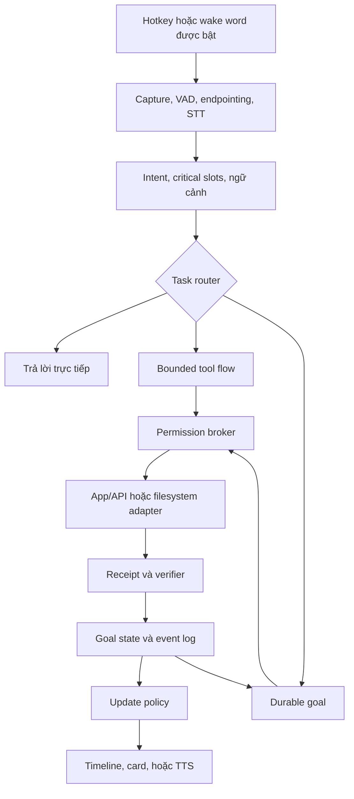

# NORA: từ một câu nói đến công việc hoàn tất

Ngày nghiên cứu: **31/10/2026 — Asia/Saigon**. Trạng thái bàn giao: nghiên cứu, thiết kế và reference policy core. Chưa có ứng dụng production hoặc kết quả benchmark giọng nói.

## Kết luận đề xuất

Xây **NORA — Natural-language Orchestration, Reasoning & Action**, đọc “Nô-ra”, gọi “Nora ơi”. Tên nhấn vào bốn việc: hiểu ngôn ngữ tự nhiên, điều phối, quyết định bước tiếp theo và hành động. Đây là codename, chưa kiểm tra nhãn hiệu hoặc độ chính xác wake word.

NORA nên là **trợ lý Windows chạy theo phiên người dùng**, có tray icon, nút tắt mic, bảng goal và quyền truy cập minh bạch. Bản đầu dùng pipeline **STT → orchestrator → TTS**, xử lý wake/VAD local khi được bật, có hotkey/push-to-talk trước. Lõi thực thi hoạt động độc lập với cuộc hội thoại: người dùng có thể ngắt lời NORA mà công việc vẫn tiếp tục trong phạm vi đã được giao.

Đích sản phẩm là **một prompt để giao một mục tiêu**, có thể cần câu trả lời bổ sung ở đúng bước thiếu thông tin hoặc quyền. Không thể bảo đảm hoàn tất mọi yêu cầu mà không hỏi lại: app có thể chưa được cấp quyền, API không hỗ trợ hoặc yêu cầu thiếu dữ liệu. Hệ thống phải giữ goal, làm tiếp phần độc lập và trình bày chính xác phần đang chờ.

Hai đường phát triển dùng chung lõi nhưng khác adapter: **LifeMate trong môi trường mô phỏng của cuộc thi** và **desktop thật trong hệ điều hành**. Điểm số trên simulator chưa chứng minh khả năng tự động hóa mọi app Windows. [Đề LifeMate](https://challenge.zalo.ai/portal/lifemate)

## 1. Tính cách từ JARVIS và FRIDAY

Lấy cảm hứng ở cách trợ lý hiểu ngữ cảnh, chủ động làm việc và nói ngắn gọn khi có điều quan trọng. Sản phẩm cần có khả năng trả lời “đang làm gì?”, “đã xong phần nào?”, “vì sao đang chờ?” từ trạng thái thật.

Chủ động phải đi cùng phạm vi: NORA không tự chọn thêm mục tiêu, cài app hay mở rộng quyền chỉ vì việc đó có vẻ hữu ích. Sự tin cậy đến từ bằng chứng và việc biết dừng. Không dùng nhân vật, giọng người nổi tiếng hoặc tài sản Marvel trong bản phân phối nếu chưa có quyền phù hợp.

## 2. Những gì đề thi thực sự yêu cầu

LifeMate nhận audio tiếng Việt có thể xen tiếng Anh; context gồm thời gian, timezone, vị trí và hồ sơ người dùng; app được mô tả bằng JSON tool schemas; có conversation history và simulated environment. Agent thực hiện ordered tool calls, gọi `sys.ask_missing_info` khi thiếu tham số, trả `[]` khi không app nào xử lý được. `state_hash` lấy từ `env.get_state_hash()` dùng kiểm tra trạng thái cuối. Không tự dựng hash từ câu trả lời model. [Portal LifeMate](https://challenge.zalo.ai/portal/lifemate)

Điều này dẫn tới ưu tiên thi: nghe đúng critical slots → chọn đúng tool → giữ thứ tự phụ thuộc → kiểm tra state. Một màn hình đẹp hoặc giọng đọc hay không thay thế được việc làm đúng. Devkit/evaluator và công thức điểm chi tiết vẫn cần lấy từ tài nguyên chính thức được phép truy cập; nghiên cứu này chưa tải bộ dữ liệu hay chạy evaluator.

Trang chính và PDF ghi hạn nộp giải pháp **16/11/2026 23:59 GMT+7**, private test **20/11 lúc 09:00**, kết quả private **23/11 lúc 23:59**, finalists **02/12**, chung cuộc **12/12**. Lịch có thể được BTC cập nhật. [Timeline](https://challenge.zalo.ai/#timeline), [thể lệ mục 3](https://dl-challenge.zalo.ai/zalo-ai-challenge-regulations-vi.pdf)

## 3. Nền tảng phù hợp

| Phương án | Đánh giá cho NORA |
|---|---|
| **Tauri 2 + Rust broker + Python sidecar** | Hướng chọn cho Windows-first: UI/tray, đường IPC có kiểm soát và hệ sinh thái audio/agent Python. Đội phải vận hành cả Rust lẫn Python |
| Electron + TypeScript | Hợp lý nếu đội mạnh TS và cần nhanh; cần theo sát Chromium/Node, sandbox, context isolation và IPC validation |
| Web app/PWA | Tốt cho dashboard hoặc companion; không thay được broker có quyền local và lifecycle nền của desktop app |
| Windows Service làm trợ lý tương tác | Không phù hợp làm UI/mic chính: services bị tách khỏi phiên người dùng; cần user process cho tương tác |
| Cloud-only agent | Hợp job không phụ thuộc máy local; không có quyền ngầm truy cập app/folder trên máy người dùng |

Đây là **quyết định kiến trúc**, chưa có số đo RAM/CPU/latency giữa Tauri và Electron. Tauri capabilities giới hạn lời gọi từ WebView vào core nhưng không sandbox Rust hoặc sidecar độc hại. Electron cũng đòi hỏi ranh giới IPC và cập nhật bảo mật. [Tauri capabilities](https://v2.tauri.app/security/capabilities/), [Electron security](https://www.electronjs.org/docs/latest/tutorial/security), [Windows interactive services](https://learn.microsoft.com/en-us/windows/win32/services/interactive-services)

Bản desktop đầu có thể chạy worker và local store trên máy người dùng. Backend chỉ cần khi bổ sung đồng bộ đa thiết bị, quản lý tài khoản, connector dùng chung hoặc job cloud. Không đưa Kubernetes, nhiều microservice hoặc hai workflow runtimes vào bản đầu chỉ để có cảm giác “agentic”.

## 4. Vòng hoạt động

Router xét dependency, khả năng chờ/resume, discovery chưa biết và acceptance criteria. Quyền/rủi ro được xét riêng. “Xóa folder A” ngắn và đơn giản về kế hoạch nhưng có tác động lớn; “tóm tắt bài này” dài vẫn có thể là một lời gọi. Không dùng độ dài prompt để suy ra cần bao nhiêu agent.

Một orchestrator mặc định. Worker song song chỉ có ích khi công việc độc lập, phạm vi rõ và chi phí phối hợp thấp hơn lợi ích. Ví dụ nhánh khảo sát ASR và nhánh kiểm tra OS permissions có thể độc lập; đặt xe theo kết quả đọc địa chỉ cần giữ thứ tự. Đây là nguyên tắc thiết kế từ phương pháp workflow/agent, không phải định luật rằng một agent luôn tốt hơn. [Anthropic engineering](https://www.anthropic.com/engineering/building-effective-agents)

## 5. Giọng nói tiếng Việt

Pipeline cascade giúp kiểm tra transcript và command có cấu trúc trước action, thay STT/TTS độc lập và đo lỗi từng tầng. Native speech-to-speech có thể cải thiện sự tự nhiên nhưng vẫn phải đi qua broker, approval và verifier. Không cho audio model trực tiếp gọi generic shell. [Voice-agent architectures](https://developers.openai.com/api/docs/guides/voice-agents)

Ứng viên baseline: Silero VAD ONNX; faster-whisper với multilingual Whisper cho ASR; Pipecat cho audio orchestration nếu spike cho thấy lợi ích. sherpa-onnx có model tiếng Việt nhỏ đáng benchmark trên CPU, nhưng model Zipformer được liệt kê là **offline**: microphone demo với VAD/simulated streaming không chứng minh native streaming. Không chốt model “tốt nhất tiếng Việt” trước test. TTS tiếng Việt cần bake-off riêng; chưa xác minh được API Zalo TTS trong lần nghiên cứu này. [Silero](https://github.com/snakers4/silero-vad), [faster-whisper](https://github.com/SYSTRAN/faster-whisper), [sherpa models](https://k2-fsa.github.io/sherpa/onnx/pretrained_models/offline-transducer/zipformer-transducer-models.html)

Wake word là milestone riêng. openWakeWord công bố code Apache 2.0 nhưng pretrained models CC BY-NC-SA 4.0 và chỉ hỗ trợ English. Danh sách ngôn ngữ Porcupine công bố không có tiếng Việt. Không thể lấy pretrained “hey jarvis”, đổi tên và coi là hợp lệ cho sản phẩm thương mại. Hotkey/push-to-talk là baseline để phát triển trước khi có model “Nora ơi” được audit quyền và đo FAR/FRR. [openWakeWord](https://github.com/dscripka/openWakeWord), [Porcupine](https://picovoice.ai/platform/porcupine/)

`stop_speaking`, `pause_goal`, `cancel_goal` là ba lệnh khác nhau. Khi người dùng ngắt lời, dừng generation/audio queue phù hợp và giữ context của phần thực sự đã phát. Cancel không thu hồi email hoặc giao dịch đã gửi. [Pipecat interruptions](https://docs.pipecat.ai/pipecat/fundamentals/interruptions)

## 6. Khi nào NORA nên cập nhật

NORA dùng **event có cấu trúc và policy**, không đọc raw chain-of-thought hoặc stream toàn bộ tool logs. User-facing explanation gồm kế hoạch ngắn, bằng chứng, quyết định và trở ngại đủ để người dùng kiểm tra.

| Nên cập nhật | Điều kiện |
|---|---|
| “Đã khởi chạy hai nhánh…” | Có worker receipts thật; sự phân công giúp hiểu cách công việc tiến triển |
| “Đã đối chiếu 8 nguồn…” | Registry xác nhận đã đọc, loại trùng URL/nội dung; không đếm search hits |
| “Giấy phép model này không phù hợp…” | Finding làm đổi lựa chọn hoặc phạm vi |
| “Cần quyền ghi note vào folder…” | Bước tiếp theo thiếu một grant cụ thể |
| “Đã lưu và kiểm tra báo cáo…” | Verifier có bằng chứng artifact/state |

Giữ im lặng mặc định với epoch/batch logs, token counts, skill initialization, retries đã tự xử lý và heartbeat không đổi. Nếu training lệch mục tiêu, timeout hoặc có vấn đề cần quyết định, phát event tổng hợp. Khi người dùng hỏi số epoch, trả lời theo yêu cầu cụ thể.

Routine updates được coalesce/rate-limit; permission/blocker/completion có priority nhưng vẫn tôn trọng người dùng đang nói và quiet mode. Bảng timeline giữ chi tiết. Reference core minh họa cooldown 45 giây và milestone tối thiểu 3 nguồn; đây là cấu hình minh họa, không phải cadence đã được thử với người dùng. Xem [progress policy](https://github.com/dakiemdarktharr/NoSleepClub_zalo_hacks/blob/main/docs/progress-policy.md).

## 7. Durable goal và bằng chứng hoàn tất

Goal giữ mục tiêu, acceptance checks, scope grants, budgets, plan version, pending approvals, checkpoints, effect receipts và evidence. Trạng thái chờ không làm mất yêu cầu gốc. Chỉ hoàn tất sau khi kiểm tra kết quả trong app/file/API.

Chọn **LangGraph để thử nghiệm workflow local**; đánh giá persistent checkpointer và crash behavior trước beta. SQLite phù hợp để đánh giá single-device state/event ledger, nhưng không mặc nhiên coi mọi SQLite LangGraph saver là storage production được hỗ trợ; tài liệu có saver dành cho development. Cần kiểm tra storage/version, transaction, locking, backup và migration. Temporal đáng cân nhắc khi có job nhiều ngày, nhiều worker/máy và backend vận hành riêng. [LangGraph checkpointers](https://docs.langchain.com/oss/python/langgraph/checkpointers), [Temporal workflows](https://docs.temporal.io/workflows)

Checkpoint không bảo đảm external action chỉ xảy ra một lần. Nếu process chết sau khi gửi email nhưng trước khi lưu receipt, retry có thể gửi lần hai. Cần effect ledger, idempotency key nếu app hỗ trợ và reconciliation theo trạng thái thật. Không xác minh được thì chuyển `needs_reconciliation`, không tiếp tục ghi mù. [LangGraph interrupts](https://docs.langchain.com/oss/python/langgraph/interrupts), [Temporal activity definition](https://docs.temporal.io/activity-definition)

## 8. Quyền app, folder và memory

Grant phải ghi rõ app/tool, resource, thao tác, thời hạn, phạm vi goal/session, egress và khả năng thu hồi. Cho đọc folder không đồng nghĩa được upload dữ liệu lên cloud. Cho dùng email không đồng nghĩa cho gửi mọi thư. Hỏi quyền khi đúng bước cần, dùng lại grant còn hiệu lực và kiểm tra lại ngay trước effect.

Ưu tiên API/connector có typed tools; browser automation kế tiếp; Windows UI Automation là fallback có giới hạn. Không nâng admin hoặc dùng UIAccess để vượt UAC. Broker xử lý canonical paths, junction/symlink và TOCTOU; IPC phải được xác thực. MCP roots chỉ mang tính thông tin, không ép server ở trong folder. [Windows UI Automation security](https://learn.microsoft.com/en-us/windows/win32/winauto/uiauto-securityoverview), [MCP roots](https://modelcontextprotocol.io/specification/2026-07-28/client/roots)

Memory tách facts có nguồn, preferences được xác nhận, chat history, workflow state và cached retrieval. Mỗi fact có nguồn/ngày/phạm vi/TTL khi cần. Model summary không tự trở thành ground truth. Dữ liệu từng đọc hợp lệ vẫn cần kiểm tra quyền hiện tại khi dùng lại. Giọng nói hoặc speaker matching không thay xác thực cho cấp quyền hoặc hành động nhạy cảm.

## 9. Production là các gate phải vượt

Đánh giá riêng: chất lượng nghe, slot quan trọng, lựa chọn tool, final state, crash recovery, update usefulness và unauthorized effects. WER thấp chưa đủ nếu sai tên người, số tiền hay folder path. Không lấy lời model nói “đã xong” làm grader. [Agent evaluation guidance](https://www.anthropic.com/engineering/demystifying-evals-for-ai-agents)

Đề xuất bộ tiếng Việt khoảng 60 người × 20 yêu cầu, cân bằng Bắc/Trung/Nam, speaker-disjoint splits, mic laptop/headset, nhiều điều kiện tiếng ồn. Đo p50/p95, worst-case và lỗi theo từng nhóm. Mục tiêu thử nghiệm ban đầu: p95 barge-in stop ≤250 ms, p95 phản hồi hữu ích đơn giản ≤2,5 s trên cấu hình được công bố. Chưa có phép đo chứng minh đạt các số này.

Trước production cần signed installer/update, rollback, dependency/model/data license audit, secrets store, retention/delete/export, fault injection, red-team prompt injection, bounded costs, revocation tests và beta theo dõi thực tế. Máy ngủ/tắt không tiếp tục chạy local goal; supervisor phải resume/reconcile khi hoạt động lại. Backend không tự có quyền điều khiển desktop khi user session không khả dụng.

## 10. Chi phí và bước tiếp theo

Ước tính chi phí theo phút audio STT/TTS, model input/output tokens, số tool calls, concurrency và storage. Đo cost per **verified completed task**, retry amplification và cost của tác vụ thất bại; không chỉ giá một triệu token. Bắt đầu bằng giới hạn step/time/cost rõ ràng, để người dùng xem phần đã làm khi chạm budget. Không chốt giá provider hoặc GPU trước benchmark và xác nhận điều kiện cuộc thi.

Ưu tiên tiếp theo: lấy và đọc devkit/evaluator được phép; chốt contract LifeMate; làm vertical slice nghe → tool simulator → final state verifier; benchmark ASR/critical slots; rồi kết nối một folder và một app thật qua broker. Wake word, nhiều app và trải nghiệm hands-free mở rộng sau khi đường này ổn định. [Lộ trình chi tiết](https://github.com/dakiemdarktharr/NoSleepClub_zalo_hacks/blob/main/docs/production-roadmap.md)

Bộ bàn giao hiện tại đã có tài liệu nghiên cứu, source ledger, ground truths, schemas và reference core với tests. Các integration, chứng minh hiệu năng và quyền production còn ở phía trước. Phạm vi cùng khoảng trống bằng chứng được ghi tại [phương pháp nghiên cứu](https://github.com/dakiemdarktharr/NoSleepClub_zalo_hacks/blob/main/docs/research/methodology.md).
